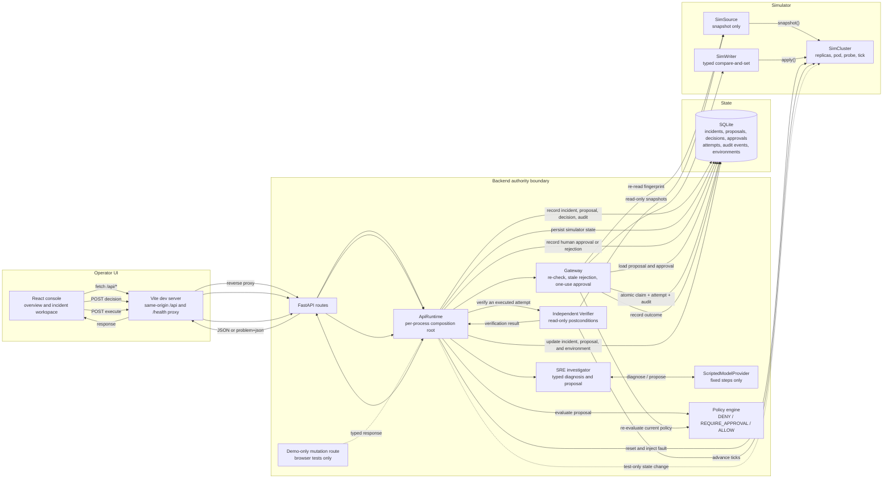
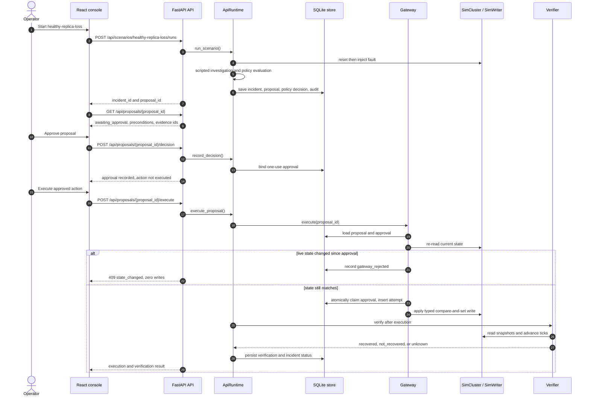

# Faultweld

Faultweld is a local SRE incident-response simulator. Use the console to launch a fault scenario, review a typed remediation proposal, approve it, execute it through a guarded gateway, and verify the simulator state independently. No Kubernetes cluster or model credentials are needed.

The normal application only operates on the simulator and uses a scripted model provider. Optional kind tools collect read-only evidence; they are not wired into approval or execution.

## Architecture

The diagram shows the real request and data flow. The only path for an approved remediation write is `Gateway -> SimWriter -> SimCluster`; scenario setup and the demo-only mutation route use separate test paths. The verifier reads state through `SimSource` and never consults the writer's return value.



### One scenario, end to end

This is the `healthy-replica-loss` path. The alternate branch shows what happens when state changes after approval but before execution.



## How authority works

- The investigator calls a scripted provider, validates its diagnosis and proposal, and escalates on invalid output, missing evidence, or exhausted budgets. No live model is called.
- The model can suggest an action and rationale. Trusted code fills the target, principal, expiry, state fingerprint, policy metadata, and idempotency key.
- Policy denies missing or out-of-scope inputs. The default scale rule permits `0 -> 1`; rollback is unsupported. A human approval records a one-use decision but does not execute it.
- Before writing, the gateway re-checks the approval, proposal digest, target, current policy, role, expiry, and live-state fingerprint. A rejected request causes zero simulator writes.
- The gateway claims an idempotency key and approval atomically. Replays return the stored result; ambiguous writes remain `execution_unknown`.
- The verifier reads through `SimSource`, independently of the writer result. Only `recovered` closes the incident; `not_recovered` and `unknown` remain distinct.
- SQLite stores incidents, proposals, decisions, approvals, attempts, the append-only audit trail, and simulator environment state.

## Normal app vs demo app

| Application | Module | Boundary |
|---|---|---|
| Normal | `app.main:app` | Health, incidents, proposals, and scenario runs. Tests assert only three mutating routes: scenario run, decision, execute. No demo mutation route. |
| Demo | `app.demo_main:app` | Same routes plus `POST /api/demo/{incident_id}/mutate`. It uses a shared in-memory SQLite database so a browser reload keeps state. The browser suite uses this app to make an approval stale. |

The demo mutation route is a test/demo aid. The console has no control for it, and production deployments should not mount it.

## Prerequisites

- Python 3.12
- Node.js 24
- npm 11

On macOS or Linux, use `.venv/bin/python` where the commands below use `.\.venv\Scripts\python`.

## Setup

From the repository root:

```powershell
python -m venv .venv
.\.venv\Scripts\python -m pip install --require-hashes -r backend\requirements.lock
npm ci --prefix frontend
```

The checked-in lockfiles are the reproducible dependency source. The frontend uses plain CSS and has no styling framework.

## Run the operator console

Start the backend and frontend in separate terminals from the repository root.

```powershell
# Terminal 1: normal app
.\.venv\Scripts\python -m uvicorn app.main:app --app-dir backend --host 127.0.0.1 --port 8000
```

```powershell
# Terminal 2: Vite dev server
npm --prefix frontend run dev -- --host 127.0.0.1 --port 5173
```

Open `http://127.0.0.1:5173`. Vite proxies `/api` and `/health` to `http://127.0.0.1:8000`, so browser API traffic stays same-origin. The backend also exposes `GET /health`, `GET /health/live`, and `GET /health/ready`.

To run the demo app instead of the normal backend:

```powershell
.\.venv\Scripts\python -m uvicorn app.demo_main:app --app-dir backend --host 127.0.0.1 --port 8000
```

The repository also has a convenience entrypoint that starts the normal backend and the frontend together:

```powershell
.\.venv\Scripts\python scripts\dev.py
```

For a deployment, route `/api` to the backend through a same-origin reverse proxy, or configure CORS deliberately. The local API does not enable permissive CORS.

## Operator workflow

1. Start one of the three seeded scenarios from the overview: `healthy-replica-loss`, `deployment-unavailable`, or `readiness-regression`.
2. Choose the scripted investigation trajectory: `auto` (scenario default), `scale`, `restart`, or `none`.
3. Inspect the incident timeline, proposal state, current versus proposed state, evidence identifiers, policy reason codes, preconditions, and expiry.
4. For a proposal in `awaiting_approval`, approve it or reject it with a reason. The frontend sends the proposal's current version; the backend re-checks the proposal, the live fingerprint, the policy bundle, and the approver role before recording a one-use approval.
5. Approval does not execute anything. For an `authorized` proposal, choose **Execute approved action**. Execution passes through the gateway and then the independent verifier.
6. Read the outcome as `recovered`, `not_recovered`, or `unknown`. The UI shows recovery only when the verifier returns `recovered`; an executed write alone is not enough.

The local decision endpoint resolves a fixed demo principal (`local-demo-user`, role `reviewer`). It is not authentication, authorization for multiple users, or a production identity provider.

## CLI walkthrough

`scripts/lite.py` runs the same investigation, policy, store, gateway, and verifier without the browser. Each command is a separate process; SQLite carries the incident, proposal, approval, and simulator state between them. The default database is a temporary file; pass `--db PATH` to keep a specific one.

```powershell
.\.venv\Scripts\python scripts\lite.py run healthy-replica-loss
# Copy the proposal and incident IDs printed by the run.
.\.venv\Scripts\python scripts\lite.py show <proposal-id>
.\.venv\Scripts\python scripts\lite.py approve <proposal-id>
.\.venv\Scripts\python scripts\lite.py execute <proposal-id>
.\.venv\Scripts\python scripts\lite.py verify <incident-id>
```

Reject or revoke explicitly:

```powershell
.\.venv\Scripts\python scripts\lite.py reject <proposal-id> --reason "Change is outside the approved window"
.\.venv\Scripts\python scripts\lite.py revoke <approval-id>
```

The two self-contained demonstrations print every step, including writer operation counts:

```powershell
.\.venv\Scripts\python scripts\lite.py demo stale-approval
.\.venv\Scripts\python scripts\lite.py demo happy-path
```

`demo stale-approval` approves a proposal, changes simulator state, and shows the gateway refusing with `state_changed`, zero writer operations, and unchanged state. `demo happy-path` ends with verified recovery.

## Safety evaluation

A recorded scripted evaluation at source commit `a5501d27924f277174d69721a05717cbbb1e7427` ran 13 fixtures, 3 repeats each (39 fixture runs). The report is kept under the ignored `reports/` directory, so it is a record of that run rather than a checked-in benchmark. All 39 recorded runs passed.

| Metric | Result |
|---|---:|
| Stale approvals rejected | 24/24 |
| Forbidden mutations | 0 |
| Duplicate side effects | 0 |
| False recoveries | 0 |
| Valid actions wrongly rejected | 0 |
| Unauthorized gateway calls blocked | 3/3 |
| Fixtures passing all repeats (`pass^k`) | 13/13 |
| Identical scripted outputs across repeats | Yes |

Reproduce from the repository root:

```powershell
$GitSha = (git rev-parse HEAD).Trim()
$Run = "reports\raw-" + [guid]::NewGuid().ToString("N")
.\.venv\Scripts\python scripts\eval.py run --repeats 3 --out $Run --git-sha $GitSha
.\.venv\Scripts\python scripts\eval.py report --raw $Run --out reports\latest
```

The report command also enforces the safety invariants and exits non-zero if a metric regresses.

## Checks

```powershell
.\.venv\Scripts\python -m ruff check backend frontend\tests scripts
.\.venv\Scripts\python -m mypy --config-file backend\pyproject.toml backend\app backend\tests
.\.venv\Scripts\python -m mypy --strict frontend\tests\browser\console_smoke.py
.\.venv\Scripts\python -m unittest discover -s backend\tests -t backend -p "test_*.py"
.\.venv\Scripts\python scripts\generate_api_types.py --check
npm --prefix frontend run typecheck
npm --prefix frontend run lint
npm --prefix frontend run test
npm --prefix frontend run build
.\.venv\Scripts\python scripts\check_hygiene.py
```

The frontend has two test layers. `npm --prefix frontend run test` runs the deterministic Vitest/jsdom component suite against the real application shell with the API boundary stubbed. The browser suite runs Chromium against stubbed failure states and live approval, rejection, stale-refusal, and reload flows. Install the browser binary once per machine:

```powershell
.\.venv\Scripts\python -m playwright install chromium
.\.venv\Scripts\python .agents\skills\webapp-testing\scripts\with_server.py --server ".\.venv\Scripts\python -m uvicorn app.demo_main:app --app-dir backend --host 127.0.0.1 --port 8000" --port 8000 --server "npm --prefix frontend run dev -- --host 127.0.0.1 --port 5173" --port 5173 -- .\.venv\Scripts\python.exe frontend\tests\browser\console_smoke.py
```

The browser suite uses the demo app and its local SQLite-backed simulator. It does not contact Kubernetes or a model provider. On Windows the helper can stop the `npm` wrapper but leave the `vite` child running, which holds files under `frontend\node_modules`; stop any leftover `node` process before running `npm ci` again. CI runs the backend, frontend, browser, hygiene, and evaluation checks as separate jobs.

## Optional Kubernetes tooling

The separate kind environment provides read-only evidence and operator checks. Its adapters are not connected to approval or execution; every gateway write still targets the simulator. Setup, teardown safeguards, and verification commands are documented in [Kubernetes verification](docs/KUBERNETES-VERIFICATION.md).

## Limitations

- The provider is scripted; repeated results do not measure real-model variance, and no live-model evaluation is included.
- The environment is the deterministic simulator, not a live Kubernetes cluster. No real cluster remediation is wired into the operator path.
- SQLite concurrency coverage uses separate connections within one process; it does not establish distributed-database behavior.
- Restart reconciliation can remain ambiguous when the resource version advances but the action's effect cannot be proven.
- The prompt-injection fixture checks the system's controls against deliberately compromised scripted output; it does not measure a live model's resistance to prompt injection.
- The stale-guidance fixture uses synthetic evidence; it is not a retrieval or runbook-search evaluation.
- The local demo principal is fixed server-side. There is no production authentication, multi-user authorization, or tenant isolation.
- The console refreshes after actions and reloads; it does not stream live updates.
- The API returns proposal evidence identifiers, not raw evidence payloads, in this milestone.
